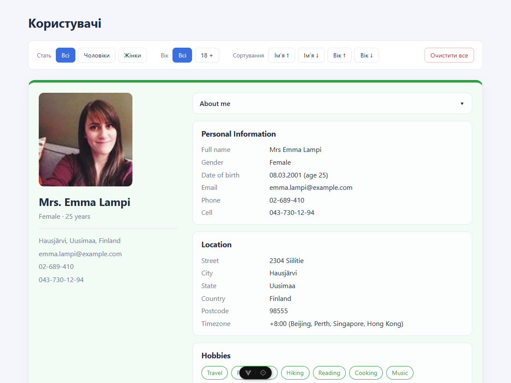
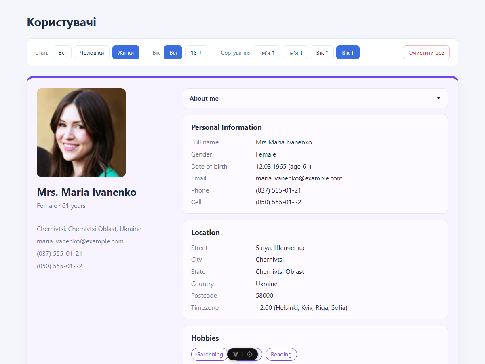
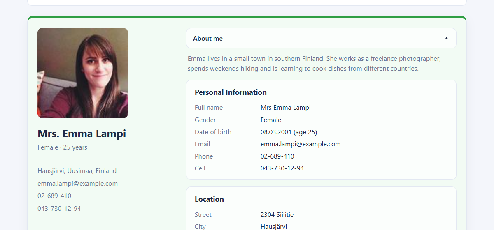

# Users: компоненти, шаблони, директиви Vue

Лабораторна робота №3 з курсу «Інженерія клієнтських веб-систем»: Vue 3 (Composition API, `<script setup>`), TypeScript, Vite.
Застосунок показує список користувачів у вигляді карток із фільтрами, сортуванням і скиданням.



|                                                  |                                                          |
| ------------------------------------------------ | -------------------------------------------------------- |
|  |  |
| Жінки, сортування за віком (за спаданням)        | Блок «About me» показується через `v-show`               |

## Запуск

```bash
npm install
npm run dev          # dev-сервер Vite
npm run build        # перевірка типів і продакшн-збірка в dist/
npm test             # Vitest (24 тести)
npm run lint:check   # oxlint + ESLint без змін файлів
npm run type-check   # vue-tsc
```

## Завдання і де вони виконані

| Завдання                                                                   | Де реалізовано                                                           |
| -------------------------------------------------------------------------- | ------------------------------------------------------------------------ |
| 1. Туторіал Vue, скріншоти кроків                                          | `public/tutorial/step-1.jpg` … `step-15.jpg`                             |
| 2. Проєкт Vue 3 з TypeScript (Composition API) і ESLint                    | створено `create-vue`, конфіги `eslint.config.ts`, `tsconfig*.json`      |
| 3. Компонент `Users.vue`, дані з `user.json`, стилі картки                 | `src/components/Users.vue`, `UserCard.vue`, дані в `src/data/users.json` |
| 4. `v-if` (вік > 18), `v-for` (хобі), `:class` за віком, `v-show` (деталі) | `src/components/UserCard.vue`                                            |
| 5. Список із 10 користувачів, фото через `v-bind`, динамічний `alt`        | `src/data/users.json`, `public/users/`, `UserCard.vue`                   |
| Повідомлення «Список юзерів пустий»                                        | `src/components/Users.vue`                                               |
| Фільтри за статтю й віком                                                  | `src/components/UsersToolbar.vue`, `src/utils/users.ts` (`filterUsers`)  |
| Сортування, яке не ламає фільтри                                           | `src/utils/users.ts` (`sortUsers`), `src/composables/useUserList.ts`     |
| Кнопка «Очистити все»                                                      | `useUserList.reset`, `UsersToolbar.vue`                                  |
| 6. Скріншоти туторіалу в `public/tutorial`                                 | `public/tutorial/`                                                       |

### Кольори карток за віком (`:class` в об'єктному синтаксисі)

| Вік      | Клас     | Колір        |
| -------- | -------- | ------------ |
| до 18    | `minor`  | помаранчевий |
| 18–30    | `young`  | зелений      |
| 31–50    | `adult`  | синій        |
| понад 50 | `senior` | фіолетовий   |

Вік показується в картці лише для користувачів **старших за 18** (`v-if="age > 18"`).

## Структура

```
src/
  components/
    Users.vue          список, тулбар, повідомлення про порожній список
    UserCard.vue       картка користувача (директиви v-if, v-for, :class, v-show)
    UsersToolbar.vue   фільтри за статтю й віком, сортування, скидання
    __tests__/         тести компонентів
  composables/
    useUserList.ts     стан фільтрів і сортування (computed + reset)
  utils/
    users.ts           чисті функції filterUsers і sortUsers
    __tests__/         тести фільтрації й сортування
  data/users.json      10 користувачів
  types/user.ts        інтерфейси User, UserName, UserLocation
  assets/main.css      базові стилі й змінні кольорів
  App.vue, main.ts
public/
  users/               фото користувачів
  tutorial/            скріншоти туторіалу Vue
docs/                  скріншоти застосунку для README
```

Фільтрація й сортування винесені в чисті функції: спочатку `filterUsers`, потім `sortUsers`, тому сортування працює над уже відфільтрованим списком і не скидає фільтри.
`sortUsers` повертає копію масиву, вихідні дані не змінюються.

## Style guide Vue

- Увімкнено набір правил `plugin:vue/flat/recommended` (категорії A, B, C style guide).
- Імена компонентів у PascalCase; багатослівні, окрім `Users.vue`, назву якого задано умовою лабораторної (виняток у `eslint.config.ts`).
- Кожен `v-for` має `:key`, `v-if` не стоїть разом із `v-for` на одному елементі.
- Props і події типізовані через `defineProps`, `defineModel` і `defineEmits`.
- Стилі компонентів `scoped`, класи за BEM-подібною схемою.

## Якість коду

- **TypeScript** (`vue-tsc`), **oxlint** і **ESLint**, **Prettier**.
- **Vitest** і **Vue Test Utils**: 24 тести (фільтри, сортування, директиви картки, порожній список, скидання).
- **CI** (GitHub Actions): на кожен push і pull request запускаються лінтери, перевірка форматування й типів, тести та збірка.
- Коміти за Conventional Commits, окремий коміт для кожного завдання.

## Розгортання

```bash
npm run deploy     # збірка + публікація dist/ у гілку gh-pages
```
